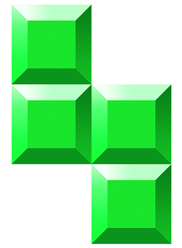

# Tetris

Juego de bloques que caen, hecho con **Flutter** para Android. Tiene un menú con video de fondo, música, controles táctiles, pausa y un registro de puntajes guardado en el teléfono.

<p align="center">
  
</p>

---

## Contenido

- [Características](#características)
- [Cómo se juega](#cómo-se-juega)
- [Estructura del proyecto](#estructura-del-proyecto)
- [Requisitos](#requisitos)
- [Instalar Flutter en Windows](#instalar-flutter-en-windows)
- [Correr el proyecto](#correr-el-proyecto)
- [Generar el APK](#generar-el-apk)
- [Pruebas](#pruebas)
- [Problemas comunes](#problemas-comunes)

---

## Características

- **Menú principal** con video de fondo en bucle (`assets/fondo.mp4`) y título con efecto de brillo.
- **Botón de sonido** para activar/desactivar el audio del video y la música del juego.
- **Tablero de 10 × 20** con las 7 piezas clásicas (L, J, I, O, S, Z, T), cada una con su color.
- **Rotación con ajuste a las paredes**: si una pieza rota pegada al borde, se empuja hacia adentro en vez de bloquearse.
- **Caída rápida**: mantener presionado el botón ↓ acelera la caída (80 ms por paso en lugar de 600 ms).
- **Animación al borrar líneas** antes de que las filas de arriba bajen.
- **Pausa / reanudar** y botón de reinicio.
- **Puntajes**: cada línea completa suma **100 puntos**. Al terminar una partida se guarda el puntaje en el teléfono (`shared_preferences`) y el botón **SCORES** muestra los 5 mejores, de mayor a menor.
- Orientación bloqueada en **vertical**.

## Cómo se juega

| Botón | Acción |
|---|---|
| ⟳ | Rotar la pieza |
| ← | Mover a la izquierda |
| → | Mover a la derecha |
| ↓ (toque) | Bajar una casilla |
| ↓ (mantener) | Caída rápida |

Completa filas horizontales para borrarlas y sumar puntos. El juego termina cuando las piezas llegan hasta arriba.

## Estructura del proyecto

```
tetris/
├── lib/
│   ├── main.dart        # Arranque de la app y menú principal (video, sonido, scores)
│   ├── board.dart       # Lógica del juego: tablero, piezas, colisiones, líneas, controles
│   ├── constants.dart   # Tamaño del tablero, tipos de piezas y sus colores
│   └── pixel.dart       # Widget de cada casilla del tablero
├── assets/
│   ├── fondo.mp4        # Video de fondo
│   ├── musica_fondo.mp3 # Música del juego
│   └── juego.png        # Icono de la app
├── test/
│   └── widget_test.dart # Prueba que el menú cargue con sus botones
├── android/ ios/ web/ windows/ linux/ macos/   # Proyectos de cada plataforma
└── pubspec.yaml         # Dependencias y assets
```

### Dependencias principales

| Paquete | Para qué se usa |
|---|---|
| `video_player` | Video de fondo del menú y del juego |
| `audioplayers` | Música de fondo |
| `shared_preferences` | Guardar los puntajes en el teléfono |
| `flutter_displaymode` | Usar la tasa de refresco más alta de la pantalla |
| `flutter_launcher_icons` | Generar el icono de la app a partir de `assets/juego.png` |

## Requisitos

| Herramienta | Versión usada |
|---|---|
| Flutter | 3.47.6 (canal stable) |
| Dart | 3.13.5 (viene con Flutter) |
| Android Studio | 2026.2 |
| Android SDK | 36 (también se usa la plataforma 35) |
| Android NDK | 28.2.13676358 (Gradle lo descarga solo) |
| Java | El JBR que trae Android Studio |

## Instalar Flutter en Windows

1. **Descargar Flutter** desde <https://docs.flutter.dev/get-started/install/windows> (archivo `.zip` del canal *stable*).
2. **Descomprimirlo** en una carpeta sin espacios, por ejemplo `C:\Users\TU_USUARIO\develop\flutter`. No usar `C:\Program Files`.
3. **Agregarlo al PATH**:
   - Buscar *"variables de entorno"* en Windows → *Editar las variables de entorno de tu cuenta*.
   - En `Path`, agregar `C:\Users\TU_USUARIO\develop\flutter\bin` y moverlo **hasta arriba**.
   - Cerrar y volver a abrir la terminal.
4. **Instalar Android Studio** desde <https://developer.android.com/studio>.
   - Abrir *SDK Manager → SDK Tools* y marcar **Android SDK Command-line Tools**.
   - Instalar el plugin de **Flutter** (*Settings → Plugins*).
5. **Aceptar las licencias de Android**:
   ```bash
   flutter doctor --android-licenses
   ```
6. **Verificar que todo esté bien**:
   ```bash
   flutter doctor
   ```
   Chrome y Visual Studio solo hacen falta para compilar para web o Windows; para Android no son necesarios.

## Correr el proyecto

```bash
git clone https://github.com/Clay666-bru/Tetris.git
cd Tetris
flutter pub get
flutter run
```

Para correrlo en un celular:
1. Activar **Opciones de desarrollador** y **Depuración USB** en el teléfono.
2. Conectarlo por USB y aceptar el aviso *"¿Permitir depuración USB?"*.
3. Revisar que aparezca con `flutter devices` y luego `flutter run`.

## Generar el APK

```bash
flutter build apk --release
```

El archivo queda en `build/app/outputs/flutter-apk/app-release.apk`. Para una versión de prueba usar `--debug` (queda como `app-debug.apk`).

Si cambias `assets/juego.png`, regenera los iconos con:

```bash
dart run flutter_launcher_icons
```

## Pruebas

```bash
flutter analyze
flutter test
```

## Problemas comunes

**`NDK ... did not have a source.properties file`**
La descarga del NDK se interrumpió. Borra la carpeta
`C:\Users\TU_USUARIO\AppData\Local\Android\Sdk\ndk\28.2.13676358` y vuelve a compilar; Gradle la descarga de nuevo.

**`cmdline-tools component is missing`**
Instálalas desde Android Studio → *SDK Manager → SDK Tools → Android SDK Command-line Tools*.

**`Android license status unknown`**
Ejecuta `flutter doctor --android-licenses` y acepta todo con `y`.

**`Device ... is not authorized`**
Desbloquea el teléfono y acepta el aviso de depuración USB.

**`dart` apunta a otra instalación**
Si instalaste Dart por separado (por ejemplo con WinGet), pon `flutter\bin` hasta arriba del PATH para que se use el Dart de Flutter.
